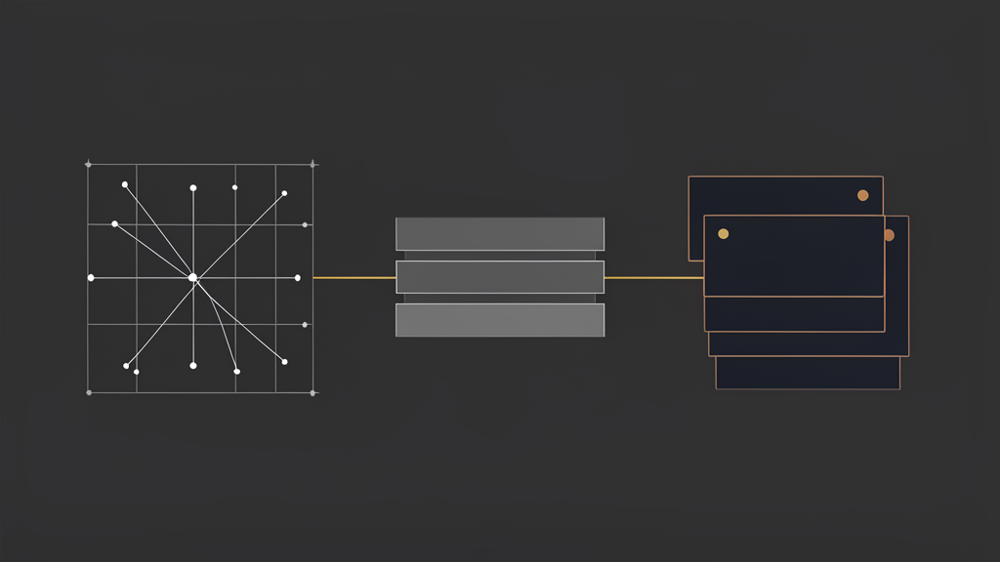

  

  
  

## Infrastructure for systems that need receipts

Most agent software records outputs. The harder question comes later: what did it
know, what did it do, and can anyone reconstruct the answer without trusting a
vendor dashboard?

Perseus Computing builds local-first infrastructure for that job. The products
work independently. Together, they cover the path from working state to durable
knowledge to a verifiable record of action.

  

| Product | Job | Start here |
|---|---|---|
| [**Perseus**](https://github.com/Perseus-Computing-LLC/perseus) | Resolves verified workspace state before an agent acts. | `pip install perseus-ctx` |
| [**Perseus Vault**](https://github.com/Perseus-Computing-LLC/perseus-vault) | Keeps durable, encrypted, time-valid knowledge in a portable local store. | One Rust binary, one file. |
| [**Perseus Ledger**](https://github.com/Perseus-Computing-LLC/ledger) | Records hash-chained events, evidence links, authority references, and optional resource allocation. | `pip install plutus-agent` during the compatibility transition. |

Perseus resolves. Vault remembers. Ledger proves.

## Built for inspection, not lock-in

- Local-first and self-hostable. Each product can run without a hosted control plane.
- Open source under permissive licenses. Read the code, keep the data, leave when you want.
- Runtime-neutral. We integrate with agent frameworks and tools without making any one of them a prerequisite.
- Evidence-oriented. A claim about a system should trace back to state, records, and artifacts someone else can inspect.

## Government and regulated work

The products are useful where deployment control and traceability matter. They
are designed to be inspectable, portable, and deployable in constrained
environments. Specific compliance claims depend on the deployment and controls
in use.

[Government procurement information →](https://perseus.observer/government/)

---

[Website](https://perseus.observer/) · [Perseus](https://github.com/Perseus-Computing-LLC/perseus) · [Vault](https://github.com/Perseus-Computing-LLC/perseus-vault) · [Ledger](https://github.com/Perseus-Computing-LLC/ledger)
