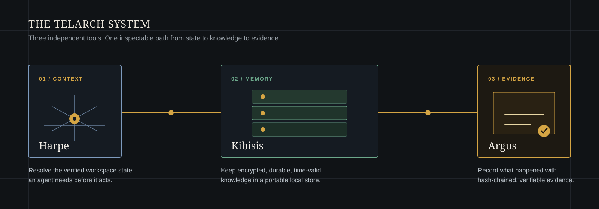

  

  <strong>Open-source infrastructure for trustworthy autonomous systems.</strong> 
  Verified context. Durable memory. Verifiable evidence.

  <a href="https://perseus.observer">Website</a> ·
  <a href="https://github.com/Perseus-Computing-LLC/perseus">Perseus</a> ·
  <a href="https://github.com/Perseus-Computing-LLC/perseus-vault">Vault</a> ·
  <a href="https://github.com/Perseus-Computing-LLC/ledger">Ledger</a>

## What we build

Most agent systems can produce an answer. The difficult part is being able to
inspect it later: what state did the system see, what knowledge did it retain,
and what record proves the action occurred?

Perseus Computing builds three local-first products for those jobs. Use one on
its own or connect them through documented contracts. No hosted control plane or
specific agent framework is required.

  

| Product | Plain-English job | Start here |
|---|---|---|
| [**Perseus**](https://github.com/Perseus-Computing-LLC/perseus) | Gives an agent the verified facts about the current workspace before it starts work. | `pip install perseus-ctx` |
| [**Perseus Vault**](https://github.com/Perseus-Computing-LLC/perseus-vault) | Keeps durable, encrypted memory so agents can retrieve past decisions and knowledge. | One Rust binary, one local file. |
| [**Perseus Ledger**](https://github.com/Perseus-Computing-LLC/ledger) | Keeps a hash-chained record of events, evidence, approvals, and optional cost allocation. | [Perseus Ledger →](https://perseus.observer/ledger/) · legacy `plutus` identifiers remain compatibility contracts. |

### The short version

- **Perseus** answers: *What does the system need to know right now?*
- **Vault** answers: *What did it learn or decide before?*
- **Ledger** answers: *What happened, and can we verify it?*

## Why local-first

Your working state, memory, and evidence trail should remain under your control.
The core products run locally or self-hosted, use open formats, and can be
inspected without trusting a vendor dashboard. External runtimes are optional
integrations, not dependencies.

## Government and constrained environments

The products are designed for environments where deployment control and
traceability matter. Specific compliance claims depend on the deployment and
controls in use.

[Government procurement information →](https://perseus.observer/government/)

---

[Website](https://perseus.observer/) · [Perseus](https://github.com/Perseus-Computing-LLC/perseus) · [Vault](https://github.com/Perseus-Computing-LLC/perseus-vault) · [Ledger](https://github.com/Perseus-Computing-LLC/ledger)
