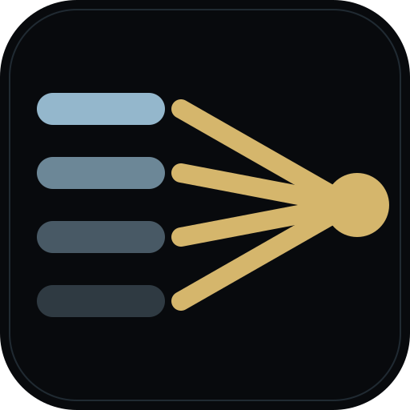

<p align="center">
  
</p>

<h1 align="center">Perseus Computing</h1>

<p align="center">
  <strong>Deterministic Context Budgeting &middot; Encrypted Agent Memory &middot; Cryptographic Audit Ledgers</strong><br>
  Telarch Cognitive Infrastructure (TCI): High-assurance, local-first runtime primitives for autonomous AI systems by Perseus Computing LLC.
</p>

<p align="center">
  <a href="https://perseuscomputing.com">Website</a> &middot;
  <a href="https://github.com/Perseus-Computing-LLC">Organization</a> &middot;
  <a href="https://crates.io/crates/harpe">Harpe Crate</a> &middot;
  <a href="https://crates.io/crates/kibisis">Kibisis Crate</a> &middot;
  <a href="https://crates.io/crates/argus-ledger">Argus Crate</a> &middot;
  <a href="https://github.com/Perseus-Computing-LLC/telarch-benchmarks">Benchmarks</a>
</p>

---

## Why Autonomous Agents Fail in Production

When engineering teams move autonomous LLM agents from conversational prototypes into production workflows, systems break down across three predictable boundaries:

1. **Unbounded Context Inflation & Attention Drift:** Agents continually append tool execution results, retrieved documents, and conversational history. As prompts swell toward model context limits, inference costs spike, latency degrades, and models suffer attention dilution ("lost in the middle")—eventually triggering hard API ceiling rejections or silent instruction drops.
2. **State Corruption & Unfenced Concurrency:** Multi-agent swarms and asynchronous workers sharing state run into uncoordinated read-modify-write races. Furthermore, conventional vector databases rely on soft-delete flags, allowing obsolete or tombstoned context to resurface in similarity searches ("carrier leakage") and contaminate downstream agent reasoning.
3. **Forensic Blindness & Compliance Failures:** Ephemeral stdout logs and mutable JSON files offer zero cryptographic tamper resistance. If an agent executes an erroneous tool call, mutates production state, or triggers an operational fault, post-hoc incident response cannot prove what occurred or whether logs were altered.

---

## The Solution: Telarch Cognitive Infrastructure (TCI)

Developed by **Perseus Computing LLC**, the **Telarch Suite** provides three decoupled, standalone infrastructure primitives engineered to eliminate these failure modes with mathematical determinism and cryptographic guarantees:

| Primitives | Core Subsystem | Guarantees & Operational Impact | Crates.io | Documentation |
| :--- | :--- | :--- | :--- | :--- |
| **Harpe** | **Context Budgeting Engine** | Enforces hard knapsack token budgets and priority pruning before model invocation. Ensures prompts never exceed capacity while preserving critical instructions. | [](https://crates.io/crates/harpe) | [](https://docs.rs/harpe) |
| **Kibisis** | **Encrypted Memory Vault** | Provides local encrypted storage with atomic Single-Writer Multi-Reader (SWMR) lease fencing and permanent cryptographic tombstoning. Eliminates race conditions and ghost state. | [](https://crates.io/crates/kibisis) | [](https://docs.rs/kibisis) |
| **Argus** | **Cryptographic Audit Ledger** | Implements an append-only, SHA-256 hash-chained event ledger that immediately fails closed upon single-bit tampering. Delivers verifiable execution provenance for NIST SP 800-53 and CMMC. | [](https://crates.io/crates/argus-ledger) | [](https://docs.rs/argus-ledger) |

All components run locally on your own infrastructure with zero external network reachback, zero cloud telemetry, and zero background daemon requirements. Released under the MIT License.

---

## Architectural Lifecycle

Each primitive is completely decoupled. You can deploy Harpe alone for prompt budgeting, Kibisis alone for local memory, Argus alone for audit logs, or compose them across the agent execution lifecycle:

```
                  AUTONOMOUS AGENT RUNTIME
                             │
  ┌──────────────────────────┼──────────────────────────┐
  │                          │                          │
  ▼                          ▼                          ▼
STAGE 01: CONTEXT          STAGE 02: MEMORY           STAGE 03: AUDIT
Harpe                      Kibisis                    Argus
Deterministic Budget       Encrypted Local Vault      Cryptographic Ledger
  │                          │                          │
  ├─ Enforce token bounds    ├─ Atomic SWMR leases      ├─ Append-only SHA-256
  ├─ Priority pruning        ├─ Envelope encryption     ├─ Continuous chaining
  └─ Assembly in <35 µs      └─ Tombstone erasure       └─ Fail-closed tamper check
  │                          │                          │
  ▼                          ▼                          ▼
Constrained Model Prompt   Consistent Agent State     Verifiable Audit Trail
```

---

## Why Telarch Suite: Architectural Comparison

| Capability Dimension | Conventional Frameworks (Mem0, Letta, LangMem) | Telarch Suite (Harpe + Kibisis + Argus) | Practical Advantage |
| :--- | :--- | :--- | :--- |
| **Token Budgeting** | Heuristic truncation or unbudgeted overflow | Deterministic 0/1 knapsack constraint compiler | Prompts guaranteed within exact token bounds; zero API ceiling crashes. |
| **Pruning Speed** | Secondary LLM summarization (~1–5 seconds) | Multi-policy priority scheduling (<35 microseconds) | Sub-millisecond latency; eliminates recurring LLM summarization costs. |
| **Memory Concurrency** | Unlocked SQLite or raw file writes; race prone | Atomic Single-Writer Multi-Reader (SWMR) lease fencing | Zero state corruption or write collisions across concurrent agents. |
| **State Deletion** | Soft-delete flags in vector shards; ghost state leaks | Canonicalized cryptographic tombstone erasure | Provable information removal; zero carrier leakage into semantic recall. |
| **Audit Provenance** | Plaintext application logs or mutable JSON | SHA-256 continuous cryptographic hash chaining | Immutable execution history; immediate fail-closed detection on tamper. |
| **Deployment Boundary** | Remote cloud services or heavy daemons | Zero-daemon embedded libraries; 100% local-first | Fully air-gapped; zero external telemetry or SaaS vendor lock-in. |

---

## Quick Start

### Installation

Add the crates to your Cargo project:

```bash
cargo add harpe kibisis argus-ledger
```

Or declare them directly in `Cargo.toml`:

```toml
[dependencies]
harpe = "0.1.0-alpha.2"
kibisis = "0.1.0-alpha.2"
argus-ledger = "0.1.0-alpha.2"
```

---

### Step 1: Enforce Deterministic Context Budgets (Harpe)

Guarantee that prompts stay under strict token ceilings without sacrificing high-priority instructions:

```rust
use harpe::{ContextBudgetEngine, ContextItem, ContextSynthesizer, PrunePolicy, TokenBudget};

fn main() -> Result<(), Box<dyn std::error::Error>> {
    let engine = ContextBudgetEngine::default();
    let budget = TokenBudget::new(2048);

    let items = vec![
        ContextItem::new(
            "system_instructions",
            "You are a verification agent. Maintain strict invariants.",
            100, // High priority (preserved)
        ),
        ContextItem::new(
            "telemetry_log_stream",
            "Sensor telemetry stream: voltage=12.4, temp=42C, payload=...",
            10,  // Lower priority (eligible for deterministic eviction)
        ),
    ];

    let report = engine.synthesize(&items, &budget, PrunePolicy::LowestPriority)?;
    println!(
        "Allocated {} tokens (pruned {} items, saved {} tokens)",
        report.consumed_tokens,
        report.pruned_item_ids.len(),
        report.pruned_tokens
    );

    Ok(())
}
```

---

### Step 2: Coordinate Memory with Atomic Leases (Kibisis)

Store encrypted state and coordinate concurrent agent workers with atomic lease fencing:

```rust
use kibisis::{InMemoryLeaseCoordinator, InMemoryMemoryVault, LeaseCoordinator, MemoryEntity, MemoryVault};
use std::time::Duration;

fn main() -> Result<(), Box<dyn std::error::Error>> {
    let mut vault = InMemoryMemoryVault::new();
    let mut coordinator = InMemoryLeaseCoordinator::new();

    // 1. Acquire an atomic write lease for a shared resource
    let lease = coordinator.acquire("task:subgoal_42", "worker_node_1", Duration::from_secs(10))?;

    // 2. Commit encrypted memory state
    let entity = MemoryEntity::new(
        "subgoal",
        "task:subgoal_42",
        "Waypoint verified: routing payload to target node.",
    );
    vault.put(&entity)?;

    // 3. Release lease upon completion
    coordinator.release(&lease)?;

    // 4. Retrieve state
    let hits = vault.search("routing payload", Some("subgoal"), 5)?;
    for hit in hits {
        println!("Found key: {} (score: {})", hit.entity.key, hit.score);
    }

    Ok(())
}
```

---

### Step 3: Record Verifiable Audit Trails (Argus)

Record every tool execution and operational decision to an immutable, tamper-evident hash chain:

```rust
use argus_ledger::{AuditLedgerReader, AuditLedgerWriter, AuditVerifier, InMemoryLedger};

fn main() -> Result<(), Box<dyn std::error::Error>> {
    let mut ledger = InMemoryLedger::new();

    // Append tool execution events
    let event = ledger.append(
        "tool.execute",
        "agent:worker_node_1",
        r#"{"action":"write_file","path":"/etc/config","status":"verified"}"#,
    )?;
    println!("Recorded event #{} with hash {}", event.sequence, &event.event_hash[..16]);

    // Verify entire chain integrity
    let report = ledger.verify_chain()?;
    assert!(report.valid, "Chain integrity breach detected!");
    println!("Ledger verified: {} events cryptographically validated.", report.total_events);

    Ok(())
}
```

---

## Measured Empirical Telemetry

All benchmarks are reproducible on bare-metal hardware via `cargo run --release -p telarch-benchmarks`:

| Subsystem | Benchmark Scenario | Measured Metric | Result | Operational Guarantee |
| :--- | :--- | :--- | :--- | :--- |
| **Harpe** | Small Context (10 items / 2k tokens) | Median Latency (p50) | **1.76 &micro;s** | Instantaneous knapsack assembly |
| **Harpe** | Large Context (200 items / 40k tokens) | Median Latency (p50) | **35.74 &micro;s** | Deterministic priority pruning |
| **Harpe** | 100,000-Turn Production Cost Curve | Token Reduction / Overruns | **84.77% reduction / 0 overruns** | 24.3 &micro;s/turn; $1,283.02 saved / 100k turns (Sonnet 3.5) |
| **Kibisis** | Sequential Write Ingestion | Ingestion Throughput | **2,098,000+ writes/s** | Zero-contention local vault storage |
| **Kibisis** | Multi-Agent SWMR Contention (16 workers) | Lease Throughput | **1,696,000+ ops/s** | 0.59 &micro;s latency; 0 split-brain conflicts |
| **Kibisis** | Multi-Agent SWMR Contention (32 workers) | Lease Throughput | **1,776,000+ ops/s** | 0.56 &micro;s latency; 0 fencing token rollbacks |
| **Argus** | 1,000,000 Sequential Merkle Events | Append Throughput | **632,170 events/s** | 1.58 &micro;s per SHA-256 block append |
| **Argus** | 1,000,000 Event Full Chain Verification | Verification Throughput | **770,758 events/s** | Validates 1,000,000 events in 1.29 s |
| **Argus** | Tamper Detection (Sequence #500,000) | Fail-Closed Detection | **640.48 ms** | Deterministic single-bit tamper detection |
| **Swarm** | Network Partition Test (50% packet drop) | Gossip Sync Throughput | **599,631 msgs/s** | 100% state convergence, 0 split-brain errors |

---

## Security Posture & Compliance

The Telarch Suite is engineered by **Perseus Computing LLC** for mission-critical, regulated, and air-gapped environments:

* **100% Local-First & Air-Gapped:** Zero external cloud dependencies, zero telemetry phone-home, and zero background daemons.
* **CAGE Code:** `22JC5` &middot; **SAM.gov UEI:** `PJS2LW7HAK35` &middot; **NAICS:** `541715` (R&D in Physical, Engineering, and Life Sciences)
* **Defense Logistics Agency JCP:** DD2345 Certified Active through August 2031 (Cert #`0092893`)
* **NIST SP 800-171 SPRS Score:** **110/110** (assessed August 2026, UID `SB00157695`)
* **CMMC Level 2 Compliance:** **110/110** self-classified (UID `S200069604`)
* **Compliance Alignment:** Supports NIST SP 800-53 controls (AU-2, AU-3, SC-13, SC-28) for verifiable audit logging and cryptographic storage.
* **Vulnerability Reporting:** Direct security correspondence to [`security@perseuscomputing.com`](mailto:security@perseuscomputing.com)
* **PGP Key Fingerprint:** `4A8E 2F1C 89B0 51E3 D6C2 7B94 F02A 198C 3E7D 5B12`

---

## Repositories & Crates

* **[harpe](https://github.com/Perseus-Computing-LLC/harpe):** Context window token budgeting and deterministic priority eviction.
* **[kibisis](https://github.com/Perseus-Computing-LLC/kibisis):** Encrypted local memory vault with atomic SWMR concurrency leases.
* **[argus](https://github.com/Perseus-Computing-LLC/argus):** Tamper-evident audit ledger with continuous SHA-256 hash chaining.
* **[telarch-benchmarks](https://github.com/Perseus-Computing-LLC/telarch-benchmarks):** Reproducible benchmark suite and stress tests.

---

<p align="center">
  <a href="https://perseuscomputing.com">perseuscomputing.com</a> &middot;
  <a href="mailto:contact@perseuscomputing.com">contact@perseuscomputing.com</a> &middot;
  <a href="mailto:security@perseuscomputing.com">security@perseuscomputing.com</a>
</p>

<p align="center"><sub>Copyright &copy; 2026 Perseus Computing LLC. All rights reserved. Released under the MIT License.</sub></p>
