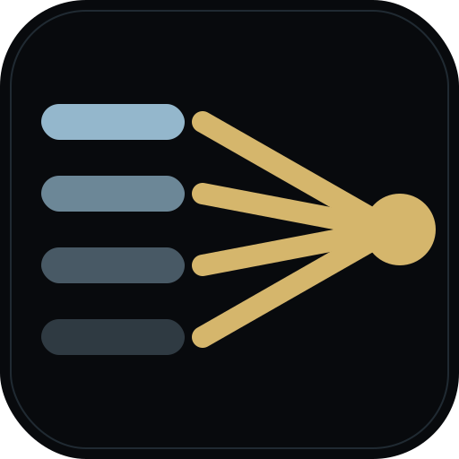

<p align="center">
  
</p>

<h1 align="center">Perseus Computing</h1>

<p align="center">
  <strong>Context for the present. Memory for the past. Evidence for what happened.</strong><br>
  Open-source, local-first infrastructure for AI agents.
</p>

<p align="center">
  <a href="https://perseus.observer">Website</a> ·
  <a href="https://github.com/Perseus-Computing-LLC/perseus">Perseus</a> ·
  <a href="https://github.com/Perseus-Computing-LLC/perseus-vault">Vault</a> ·
  <a href="https://github.com/Perseus-Computing-LLC/ledger">Ledger</a>
</p>

## The system around the model

An agent can produce an answer and still leave important questions unanswered:
what state did it see, what did it remember, and what record shows what happened?

Perseus Computing builds the local-first infrastructure around the model. The
products run independently or together, use documented interfaces, and do not
require a hosted control plane or a particular agent framework.

<p align="center">
  
</p>

## Three layers, one inspectable path

| Layer | Product | What it does | Start here |
| --- | --- | --- | --- |
| **Present** | [**Perseus**](https://github.com/Perseus-Computing-LLC/perseus) | Resolves the verified workspace facts an agent needs before a session starts. | `pip install perseus-ctx` |
| **Memory** | [**Perseus Vault**](https://github.com/Perseus-Computing-LLC/perseus-vault) | Stores durable, encrypted, time-aware memory in a portable local database. | [Install Vault →](https://perseus.observer/vault/#install) |
| **Evidence** | [**Perseus Ledger**](https://github.com/Perseus-Computing-LLC/ledger) | Records events, evidence, approvals, and other consequential actions in a hash-chained trail. | [Explore Ledger →](https://perseus.observer/ledger/) |

In one sentence:

- **Perseus** answers: _What does the system need to know right now?_
- **Vault** answers: _What did it learn or decide before?_
- **Ledger** answers: _What happened, and can we verify it?_

Existing integrations may still use `plutus` identifiers; those remain
compatibility contracts where documented.

## Start locally

Install the context engine in a project and render its first workspace briefing:

```bash
pip install perseus-ctx
cd your-project
perseus quickstart
```

Then add the layers you need:

- [Perseus quickstart](https://github.com/Perseus-Computing-LLC/perseus/blob/main/docs/quickstart.md)
- [Perseus Vault](https://github.com/Perseus-Computing-LLC/perseus-vault)
- [Perseus Ledger](https://github.com/Perseus-Computing-LLC/ledger)
- [Integrations](https://perseus.observer/integrations/)

## Why local-first

Your project context, memory, and evidence trail should stay under your control.
The core products run locally or self-hosted, use inspectable formats, and keep
external runtimes optional rather than making them dependencies.

- No required hosted control plane
- No required cloud account for the local path
- Works with MCP-compatible assistants and agent frameworks
- MIT-licensed core projects

## For constrained environments

The products are built for deployments where boundary control and traceability
matter. Actual security and compliance properties depend on how a deployment is
configured and operated.

[Government and constrained-environment information →](https://perseus.observer/government/)

## Explore the work

- [Perseus methods and benchmarks](https://perseus.observer/benchmarks/)
- [Perseus integrations](https://perseus.observer/integrations/)
- [Perseus Computing website](https://perseus.observer/)
- [GitHub Sponsors](https://github.com/sponsors/tcconnally)

---

<p align="center">
  <a href="https://perseus.observer">perseus.observer</a> ·
  <a href="https://github.com/Perseus-Computing-LLC">GitHub organization</a> ·
  <a href="https://github.com/Perseus-Computing-LLC/.github/issues">Questions and discussions</a>
</p>

<p align="center"><sub>Open-source infrastructure for agents that need context, continuity, and proof.</sub></p>
